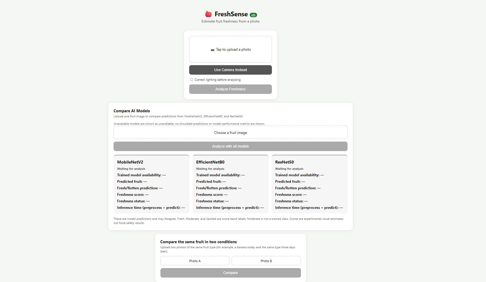
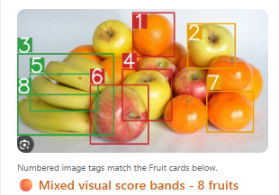
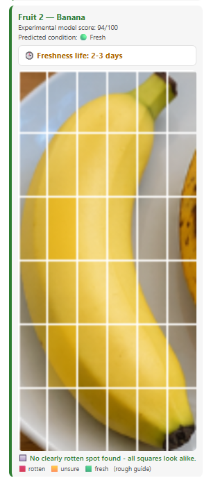
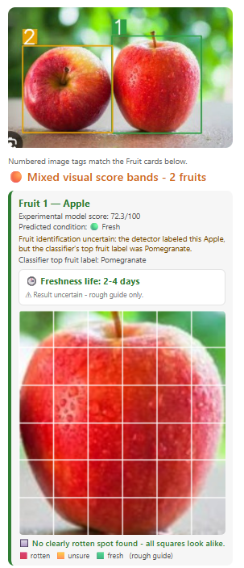
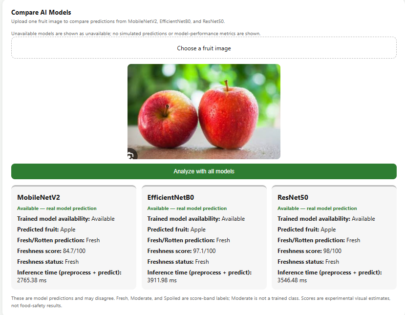

# FreshSense: AI-Based Fruit Freshness Detection System

## Project Overview

FreshSense is a web application that estimates fruit freshness from a photo. It detects fruit objects, analyses each detected fruit and displays a freshness score and status.

The result is a visual estimate only. It is not a food-safety test.

## Problem Statement

Checking fruit by eye can be difficult, especially when several fruits are in one image or when visible changes are unclear. A computer-based image check can provide a consistent starting point, but its result may still be affected by lighting, image quality and the fruit shown.

## Objectives

- Detect and analyse fruit in uploaded or captured images.
- Estimate a freshness score for each fruit.
- Show the result in a clear, beginner-friendly interface.
- Provide image comparison and model comparison options.
- Make the limits of the estimates clear to users.

## Key Features

- **Fruit detection:** Uses YOLO11n to locate supported fruit objects.
- **Multiple-fruit analysis:** Finds and analyses up to eight detected fruit objects in one image.
- **Freshness classification:** Uses the included MobileNetV2-based classifier to estimate fruit type and condition.
- **Image processing and cropping:** Prepares separate fruit crops for analysis; uses contour-based regions when YOLO does not provide supported detections.
- **Freshness score and status:** Shows a score from 0 to 100 and assigns a Fresh, Moderate or Spoiled / Not Fresh status band.
- **Image comparison:** Compares the largest fruit in two photos and reports the score difference. It warns when the predicted fruit types differ.
- **AI Model Comparison interface:** Provides comparison cards for MobileNetV2, EfficientNetB0 and ResNet50. If a trained model is unavailable at runtime, its card can show a clearly labelled illustrative demo instead of a model prediction.
- **User-friendly interface:** Supports image upload and camera capture, with optional lighting correction.
- **Additional visual guidance:** Displays image lighting information, marked fruit regions and an experimental grid view of possible problem areas. Some results also include a rough shelf-life estimate.

## Application Screenshots

### 1. Home Page


### 2. Multiple Fruit Detection


### 3. Freshness Analysis Result


### 4. Image Comparison


### 5. AI Model Comparison


## Technologies Used

| Technology | Purpose |
|---|---|
| Python | Runs the backend, image analysis and model code. |
| Flask | Provides the web server and API endpoints. |
| Flask-CORS | Allows the web page to send requests to the backend from another origin. |
| TensorFlow / Keras | Loads and runs the fruit freshness classifier and compatible comparison models. |
| YOLO11n / Ultralytics | Detects supported fruit objects in images. |
| PyTorch | Provides the runtime used by Ultralytics. |
| OpenCV | Processes images, creates fruit crops and supports visual analysis. |
| NumPy | Handles image arrays and numerical calculations. |
| Pillow | Reads and checks uploaded image files. |
| HTML, CSS and JavaScript | Build the browser-based user interface. |

## System Workflow

1. The user uploads an image or takes a photo with the camera.
2. The browser sends the image to the Flask backend. The user may also choose lighting correction.
3. The backend checks that the uploaded file is a supported image. Very dark photos are not analysed.
4. YOLO11n looks for supported fruit objects: apples, bananas and oranges. If it cannot provide detections, the backend tries image-contour regions instead.
5. The backend crops detected regions and runs the freshness classifier on them. If the classifier cannot be used, a basic colour-based estimate is available; that fallback cannot identify the fruit.
6. FreshSense calculates a score and assigns a status band to each result. It also prepares annotations and other available visual guidance.
7. The backend returns the results to the page, which displays them to the user.

## System Architecture

FreshSense follows a frontend-backend architecture. The frontend allows users to upload images and view results. The Flask backend handles image processing, fruit detection and freshness classification. The processed results are then sent back to the frontend and displayed to the user.

```
+--------------------------------------+
| USER INTERFACE                       |
| Upload or capture an image           |
| Frontend: HTML, CSS and JavaScript   |
+--------------------------------------+
                   |
                   v
+--------------------------------------+
| BACKEND                              |
| Flask receives and manages requests  |
+--------------------------------------+
                   |
                   v
+--------------------------------------+
| AI & IMAGE PROCESSING                |
| YOLO11n detects fruit                |
| OpenCV processes images and crops    |
| MobileNetV2 classifies freshness     |
| Model comparison: optional           |
+--------------------------------------+
                   |
                   v
+--------------------------------------+
| RESULTS                              |
| Fruit type, freshness score, status  |
| Sent back to the frontend            |
+--------------------------------------+
```

## Model Overview

| Model | Intended role in FreshSense |
|---|---|
| **YOLO11n** | A pretrained object detector that locates apples, bananas and oranges. Its detection confidence is separate from the freshness score. |
| **MobileNetV2** | The included classifier used to estimate fruit type and fresh/rotten condition. Its metadata lists eight fruit types, each with fresh and rotten labels. |
| **EfficientNetB0** | An optional classifier architecture represented in the model-comparison interface for comparing fruit and condition predictions when a trained model is available. |
| **ResNet50** | An optional classifier architecture represented in the model-comparison interface for comparing fruit and condition predictions when a trained model is available. |

The classifier's score is an experimental model output, not a calibrated probability. Fresh is 70 or higher, Moderate is 40 to below 70, and Spoiled / Not Fresh is below 40. These are score bands, not separate trained classes, and they do not establish whether food is safe to eat. The project does not report independent model evaluation results.

The classifier metadata lists apple, banana, grape, guava, jujube, orange, pomegranate and strawberry. YOLO11n detection in the application is limited to apples, bananas and oranges; other classifier fruit types may be analysed through the contour-based fallback.

## Project Structure

```text
freshsense15/
├── backend/
│   ├── app.py                       # Flask server, web page delivery and API endpoints
│   ├── freshness_model.py           # Detection, image analysis and freshness results
│   ├── grid_map.py                  # Creates the fruit condition grid visual
│   ├── model_comparison.py          # Runs the classifier comparison workflow
│   ├── shelf_life.py                # Produces rough shelf-life guidance
│   ├── calibrate_gate.py            # Optional script for adjusting the fruit check
│   ├── lighting_test.py             # Optional script for checking lighting changes
│   ├── requirements.txt             # Python dependencies
│   ├── model/
│   │   ├── fruit_condition.keras    # Included fruit freshness classifier
│   │   ├── metadata.json            # Class labels and model input details
│   │   └── yolo11n.pt               # YOLO11n object-detection weights
│   ├── test_compare.py              # Tests image comparison
│   ├── test_freshness_status.py     # Tests freshness status bands
│   ├── test_grid_map.py             # Tests the fruit grid visual
│   ├── test_model_comparison.py     # Tests model comparison
│   ├── test_multi_fruit.py          # Tests multi-fruit analysis
│   ├── test_object_detector.py      # Tests detection and crop handling
│   ├── test_score_softening.py     # Tests freshness score adjustment
│   └── test_shelf_life.py           # Tests shelf-life estimates
├── frontend/
│   └── index.html                   # Upload, camera, analysis and comparison interface
├── model/
│   └── train.py                     # Script for training a MobileNetV2 classifier
├── testdata/
│   ├── banana_plate_failure.png     # Image fixture used by a regression test
│   └── mixed_fruit_failure.png      # Image fixture used by a regression test
└── README.md
```

## Installation and Setup

The following steps are for Windows PowerShell. Run them from the project folder (the folder containing this README). Python 3.11 is used by the included project environment.

1. Create and activate a virtual environment:

   ```powershell
   py -3.11 -m venv .venv
   .\.venv\Scripts\Activate.ps1
   ```

2. Install the dependencies listed by the project:

   ```powershell
   python -m pip install --upgrade pip
   python -m pip install -r backend\requirements.txt
   ```

3. Start the backend:

   ```powershell
   python backend\app.py
   ```

4. Open [http://localhost:5050](http://localhost:5050) in a browser. The backend serves the frontend page at this address.

The first dependency installation may take some time because it includes image-processing and machine-learning packages.

## API Endpoints

All image requests use `multipart/form-data`. Supported upload formats are PNG, JPG, JPEG and WebP. The optional `normalize` field enables lighting correction when set to `1`, `true`, `on` or `yes`.

| Method | Endpoint | Purpose and request fields |
|---|---|---|
| `GET` | `/api/health` | Returns the API service status. |
| `POST` | `/api/analyze` | Analyses one image. Required field: `image`. |
| `POST` | `/api/compare` | Compares two images. Required fields: `image_a` and `image_b`. |
| `POST` | `/api/compare-models` | Runs the model-comparison workflow on one image. Required field: `image`. |

## Future Improvements

- Evaluate the models with a larger, varied dataset and report suitable evaluation measures.
- Improve classification through better training data and careful model evaluation.
- Improve fruit detection in crowded images, on complex backgrounds and for fruit types not covered by the detector.
- Test how lighting, camera quality and image conditions affect results.

## Conclusion

FreshSense combines fruit detection, image analysis and a browser interface to provide experimental freshness estimates from photos. Its scores can help users review fruit images, but should not replace a person's judgement or a food-safety check.
